# EMK

[](https://github.com/eriklieben/emk/actions/workflows/release.yml)
[](LICENSE)
[](https://github.com/semantic-release/semantic-release)

[](https://sonarcloud.io/summary/new_code?id=eriklieben_emk)
[](https://sonarcloud.io/summary/new_code?id=eriklieben_emk)
[](https://sonarcloud.io/summary/new_code?id=eriklieben_emk)
[](https://sonarcloud.io/summary/new_code?id=eriklieben_emk)
[](https://sonarcloud.io/summary/new_code?id=eriklieben_emk)

[](https://www.rust-lang.org)
[](https://dotnet.microsoft.com)
[](https://github.com/foostan/crkbd)
[](https://nicekeyboards.com/nice-nano)

**Rust firmware for split Corne keyboards on the nice!nano.** EMK (Erik's Mechanical Keyboard)
runs both halves over Bluetooth with animated OLED screens, 10 computer profiles plus USB,
pairing with a typed code, smooth mouse keys and live keymap editing. A desktop app emulates the
whole keyboard from the same code, and debugs, edits and flashes the real one.

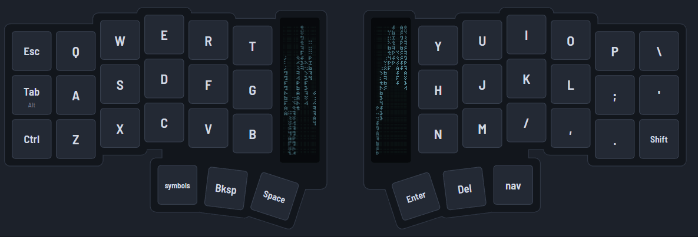

- Corne v3 (3 × 6 keys and 3 thumbs a side), nice!nano v2 (nRF52840), a 128 × 32 OLED on each half
- Left half talks to the computer (USB or Bluetooth), right half links to it over Bluetooth
- Firmware on [Embassy](https://embassy.dev) and [trouble-host](https://github.com/embassy-rs/trouble), keymap engine and screens in `no_std` Rust
- A desktop app that runs the same firmware logic as an emulator, and debugs, edits and flashes the real keyboard

## What it does

This is my own Corne firmware, set up the way I like it:

- **Animated OLEDs.** Upright screens on both halves: a start-up animation, digital rain while
  typing, a sliding layer name, modifier bars, messages from the computer, and a melt-down before
  sleep.
- **10 Bluetooth profiles, and USB as one more.** The profile keys step through BT 1-10 and USB as
  one ring; the screen shows which profile is connected, open or taken.
- **Pairing with a code.** The computer shows a 6-digit code and you type it on the keyboard, so a
  pairing is protected against a man in the middle, also when the Corne is the computer's only
  keyboard.
- **Mouse keys that feel like a pointer.** Smooth acceleration, one-pixel taps, smooth scrolling,
  and a mouse mode on the nav layer that turns Backspace and Space into clicks only once the pointer
  moved.
- **Live keymap editing (Studio)** from the app, saved to flash, and only while unlocked with a key
  on the keyboard itself.
- **A companion app** with an emulator of the whole keyboard (both OLEDs from the real screen code),
  a live debug view of the real keyboard, Studio and flashing.
- **Tested without hardware**: the keymap engine, screens and Studio in unit tests and in the
  emulator; the Bluetooth code against an in-memory Bluetooth controller (`blesim`).

## Features

### Screens and animations

Every key press drops a trail of digital rain (made-up glyphs, never the keys typed). The left
screen shows the profile, battery, layer and held modifiers; the right screen its own battery and
messages from the computer.

The pictures show the keyboard as the companion app draws it, running the firmware's own code.

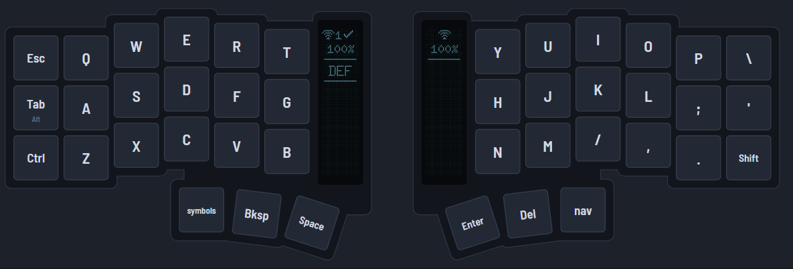

Holding symbols slides the layer name to `SYM`; holding nav to `NAV`, and moving the pointer adds the
`MOUSE` bar. T + Y turns on caps word (the layer row blinks), and held Ctrl and Shift get a bar
each:


When one half is switched on alone, it rains and asks for the other half; the start-up plays on
both halves together once they link:

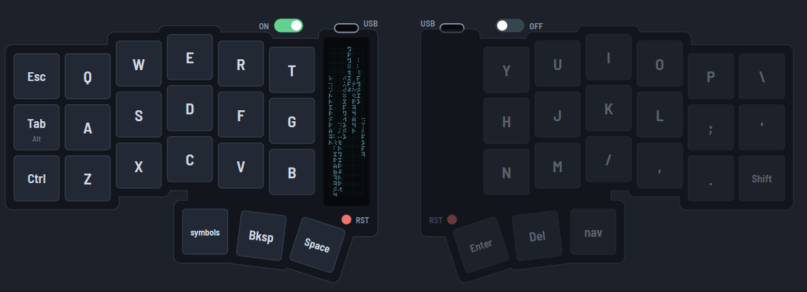

### Bluetooth and profiles

A profile is a slot for one paired computer, and USB is one more. `Profile ◀` / `Profile ▶` on the nav layer
(Z and X) step through BT 1-10 and USB as one ring (BT 10, USB, BT 1). Next to the profile number:

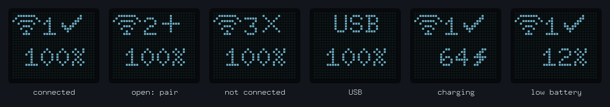

- `✓` connected, `+` open (ready to pair; only then is the keyboard discoverable), `✗` taken by a
  computer that isn't connected. The Bluetooth icon pulses while it searches.
- Pressing both profile keys at once forgets the selected profile's computer.
- A USB cable alone (charging) doesn't take the keys away from a Bluetooth profile.
- The computer sees two batteries: the left half's and the right half's.

### Pairing with a code

The keyboard tells the computer it is a keyboard without a screen, so a computer with a screen
(Windows, Linux/BlueZ, macOS) shows a 6-digit code and the left OLED asks for it. Type the code with
the digits on the symbols layer, Backspace takes one back, Enter sends it, Escape cancels.

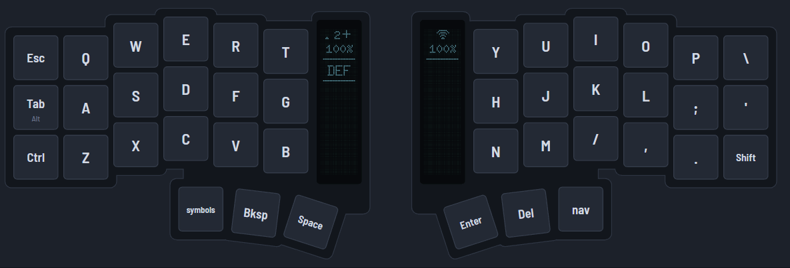

- Nothing typed while the prompt is up reaches any computer.
- A wrong code fails the pairing; after 60 s without Enter it is rejected.
- A computer that offers numeric comparison gets the code shown with `ENTER = YES` / `ESC = NO`.
- A computer with no screen or keyboard pairs without a code (no protection against a man in the
  middle); the log says which way it paired.
- The link between the halves always pairs by itself.

### Mouse keys

Hold nav: S D F G move the pointer, A is the middle click, Tab held makes it precise. Once the
pointer moved (mouse mode, the `MOUSE` bar), W E R T scroll and the Backspace / Space thumbs click.
Before that they stay F2-F5, Backspace and Space, so holding nav to delete still works.

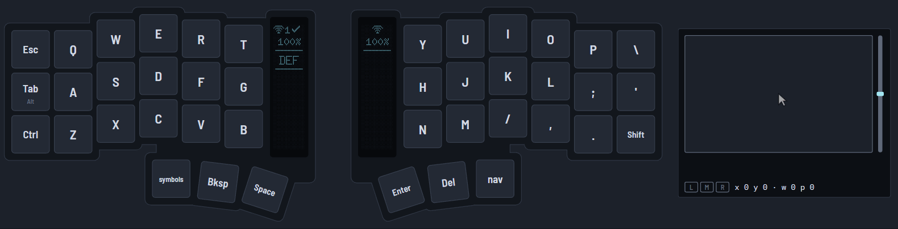

The pointer eases in and speeds up to 1800 px/s, a tap moves it one pixel, diagonals are as fast as
straight lines, and scrolling ramps the same way (smooth 1/16-detent scrolling on Windows and
Linux). Details: [docs/mouse-keys.md](docs/mouse-keys.md).

### Studio: live keymap editing

The app edits every key and combo while the keyboard runs, and saves them to flash. Writes only
work after pressing the `Studio` key on the keyboard (hold nav, press the right outer bottom key);
it locks itself again after 5 minutes, and the left screen shows `STUDIO / OPEN` or `LOCKED`.
Studio refuses any change that would leave no way to unlock it again. Protocol and rules:
[docs/studio-protocol.md](docs/studio-protocol.md).

### Messages from the computer

`kbnotify` sends a short text; the right screen builds an envelope out of the rain, decodes the
text, scrolls it when it is long, and lets it fall away when it is cleared or after 15 seconds.
It goes to the emulator when that runs, else to the keyboard over USB when the left half is plugged
in, else over Bluetooth (Raw HID, usage page 0xFF60; the left half forwards it to the right half).

```sh
# Linux (from the repo)
dotnet run --project emulator/KbNotify -- "Build passed"
dotnet run --project emulator/KbNotify -- --clear
dotnet run --project emulator/KbNotify -- --list                 # what it found, in the order it tries
dotnet run --project emulator/KbNotify -- --device /dev/hidraw5 "Hi"

# Windows: build once (on any machine), then copy kbnotify.exe over
dotnet publish emulator/KbNotify -c Release -r win-x64 --self-contained -p:PublishSingleFile=true -o target/kbnotify-win
kbnotify.exe "Build passed"
kbnotify.exe --list
```

- **Linux** needs write access to the keyboard's `/dev/hidraw*`: the udev rule in
  [docs/firmware.md](docs/firmware.md#log-port-and-hil) (its `hidraw` line).
- **Windows** needs nothing extra: the Raw HID collection is a HID device of its own that any
  program may open.
- At most 128 bytes of UTF-8; control characters are left out. Any program on a computer the
  keyboard is connected to can show a message this way; that is all it can do (text on the right
  screen, no keys).


### Power and battery

The screens blank after 30 s idle; after an hour the keyboard goes into deep sleep, except on USB
power (the key that wakes it is not typed). Before the screens go dark they melt down and a cursor blinks:


The battery shows a bolt instead of `%` on USB power and blinks at 15 % or less. While resting, the
halves' link slows from 7.5 ms to 45 ms to save power, so the first key after a rest can take up
to 45 ms.

### Radio power

The `Radio` key on the nav layer (B) steps the left half's transmit power +8 → +4 → 0 → +8 dBm (a
new keyboard starts at 0 dBm). It applies at once to the computer's link and the right half's, is
kept in flash, and shows on the left screen for 2.5 seconds. The right half transmits at 0 dBm.


## Keymap

The whole keymap on one poster (Studio → Export poster…):

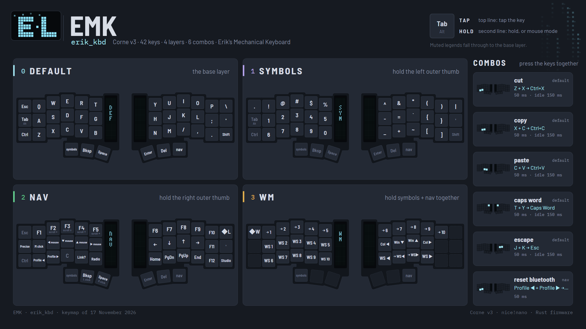

Four layers and six combos, in `core/src/keymaps/corne.rs` (translated from my ZMK config). Each
picture is the keyboard with that layer held, as the app draws it: the held thumb keys are lit and
the left screen shows the layer name. Two-line legends: the first line is the tap, the second what
the key does when held (or, on nav, in mouse mode). `◆` is the Win key on Windows and Super on Linux, so
`◆L` is Win+L.

**default**

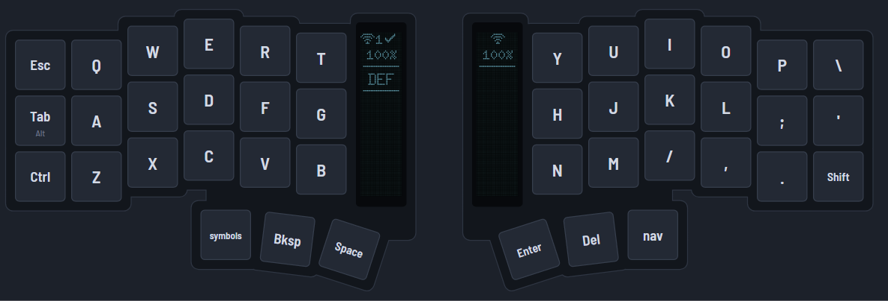

**symbols**: hold the left outer thumb

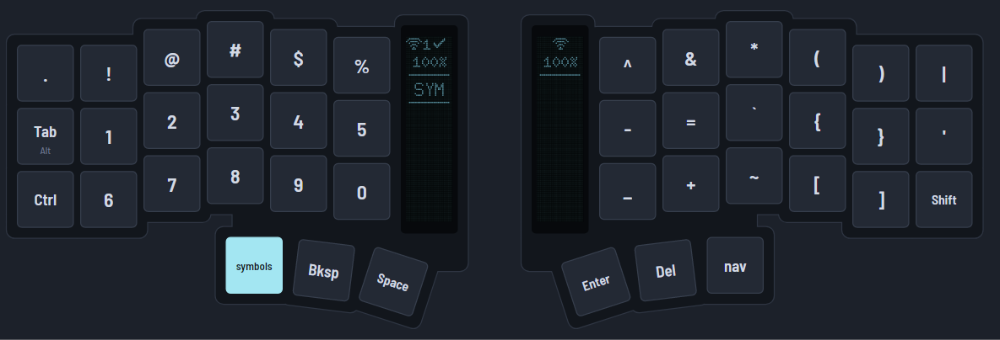

**nav**: hold the right outer thumb

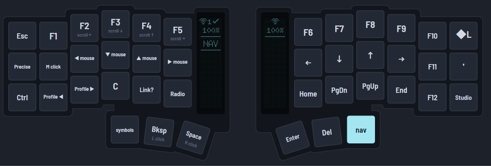

**nav in mouse mode**: the pointer moved (the `MOUSE` bar), the Backspace thumb held is a left click

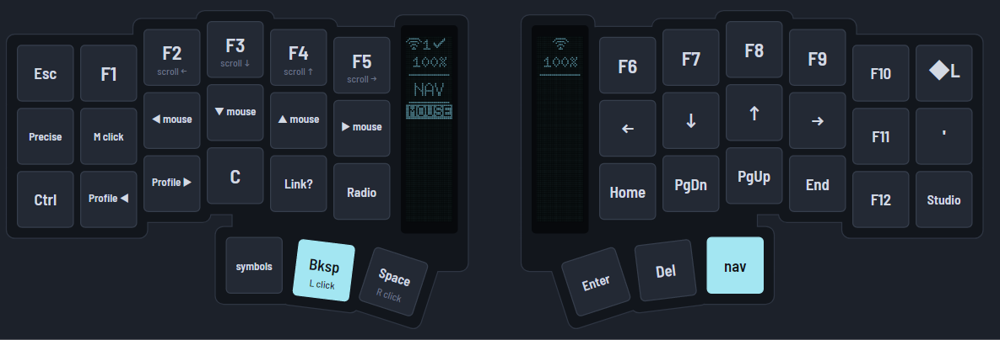

On nav, W E R T show `F2` / `scroll ←` and the thumbs `Bksp` / `L click` and `Space` / `R click`:
the second line is what they do in mouse mode, which starts with the first pointer move after nav
comes up and ends when you let go of nav.

**wm**: hold symbols and nav together. This layer is for tiling window managers, like
[Hyprland](https://hyprland.org) on Linux or erikwm on Windows: `WS n` goes to workspace n, `→ n`
sends the window there, and the arrows move focus and windows.

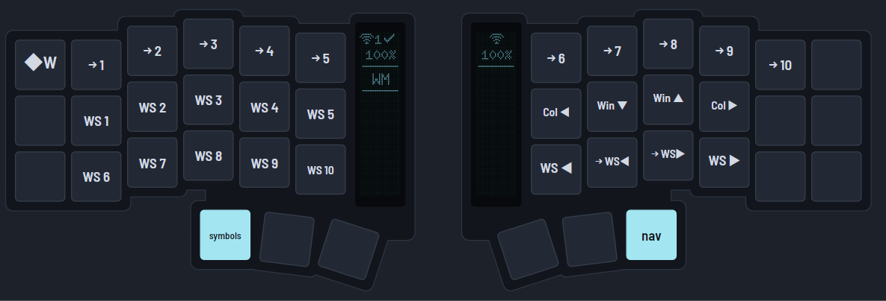

**Combos**: press both keys together, within 50 ms. The combos on the default layer ignore presses
that come within 150 ms of the previous key, so rolling over `xc` while typing never copies.

| Z + X → Cut (Ctrl+X) | X + C → Copy (Ctrl+C) |
|---|---|
| 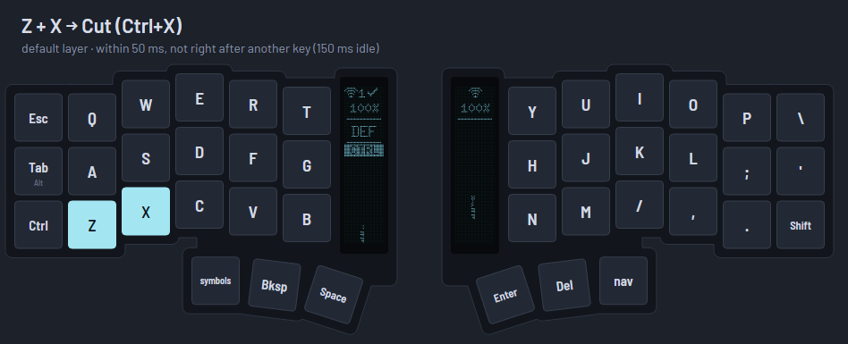 | 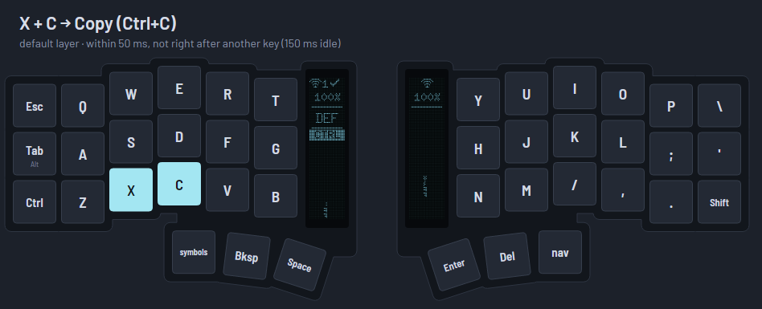 |
| **C + V → Paste (Ctrl+V)** | **T + Y → Caps word** |
| 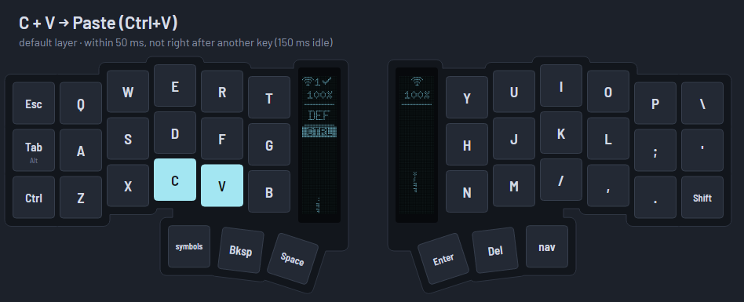 | 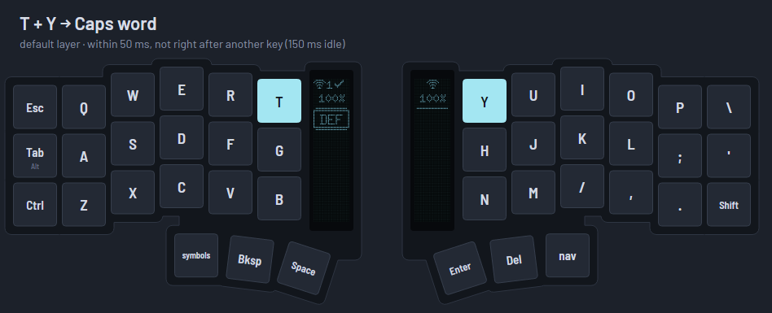 |
| **J + K → Esc** | **nav: Profile ◀ + Profile ▶ → forget the profile's computer** |
| 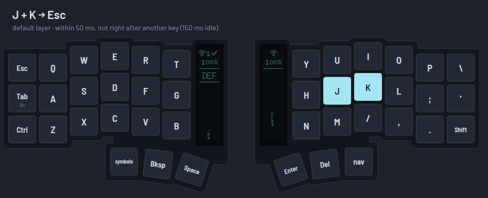 | 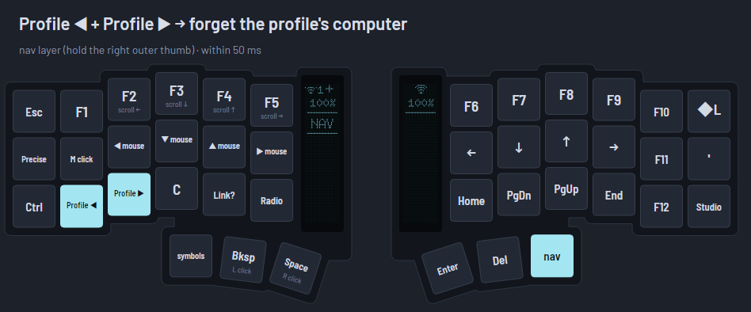 |

<details>
<summary>The layers as printable SVG (light and dark)</summary>

Keys that fall through to the default layer are dimmed, keys that do nothing are dashed, and the
mouse legends on nav are in the accent colour.

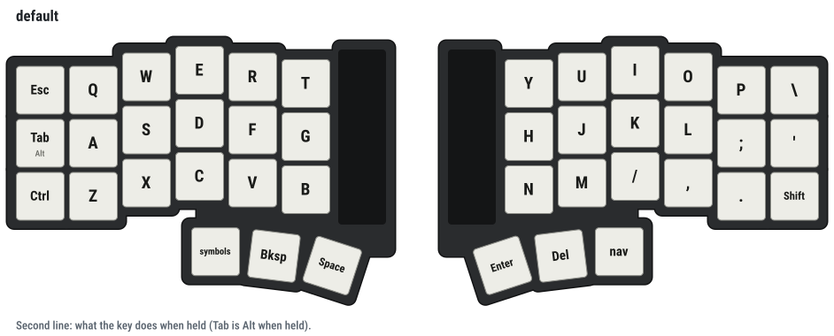
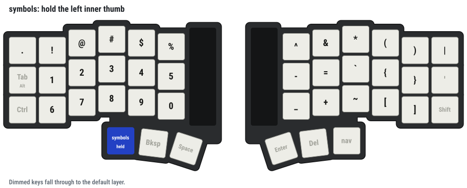
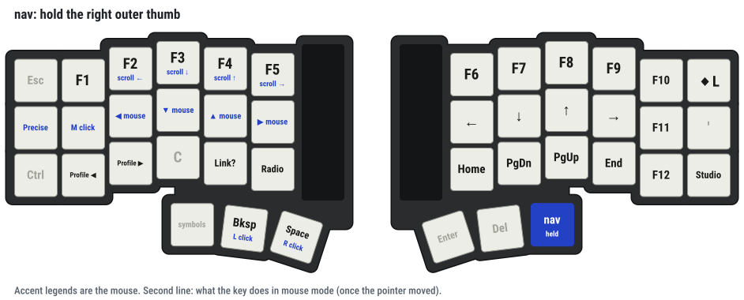
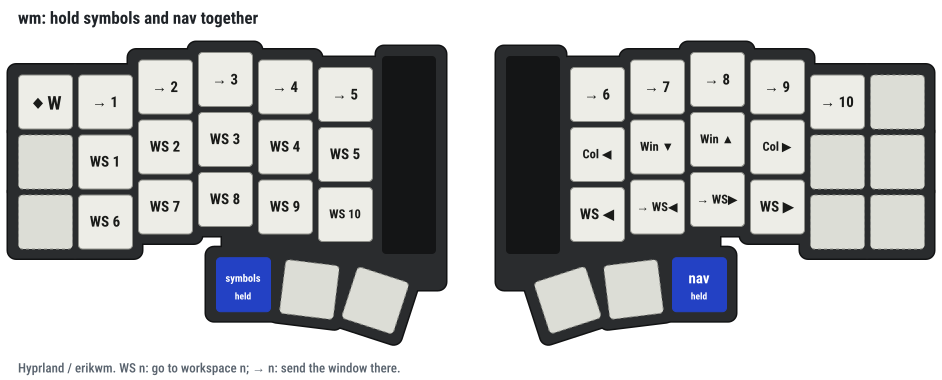

</details>

## Getting started

### Hardware

- A Corne v3 (6 columns, 3 thumb keys a side) with a nice!nano v2 on each half
- A 128 × 32 SSD1306 OLED on each half
- A battery per half for Bluetooth

### Build and flash

Rust runs in a podman container (`./dev`), so nothing needs installing on the host except podman,
and the .NET 10 SDK for the app.

```sh
BLE=1 ./fw-nrf/build-uf2 erik_kbd              # left half  → target/fw-nrf-left-ble-erik_kbd.uf2
BLE=1 SIDE=right ./fw-nrf/build-uf2 erik_kbd   # right half → target/fw-nrf-right-ble-erik_kbd.uf2
./hil flash left       # restarts the left half into its bootloader through its log port
./hil flash right      # double-tap the right half's reset button first
```

The keyboard name (`erik_kbd`) is what the computer sees. Without `./hil`: double-tap reset on a
nice!nano and copy the `.uf2` onto the `NICENANO` drive.

### First pairing

1. **The halves** pair with each other by themselves. The link stage shows at the bottom of both
   screens until they are linked.
2. **A computer**: hold nav and step with `Profile ◀` / `Profile ▶` to a profile with `+`, start pairing
   on the computer, then type the code it shows (hold symbols for the digits) and press Enter.

## Daily use

| What | How |
|---|---|
| Switch computer | nav + `Profile ◀` / `Profile ▶` (Z / X): BT 1-10, then USB |
| Forget a profile's computer | nav + both profile keys at once |
| Radio power | nav + `Radio` (B): +8, +4, 0 dBm |
| Mouse | nav + S D F G; mouse mode turns W E R T into scrolling and the thumbs into clicks |
| Caps word | T + Y together |
| Studio unlock | nav + `Studio` (right outer bottom key) |
| Show the halves' link | nav + `Link?` (V) |
| Message to the screen | `dotnet run --project emulator/KbNotify -- "Build passed"` (Windows: `kbnotify.exe "Build passed"`) |
| Pair the halves again | hold the outermost top key (Tab/Esc left, `\` right) while resetting each half, until `PAIR / forgetting other half` |
| Back to ZMK | double-tap reset and copy a ZMK `.uf2` (local backups in `backup/zmk/`), then pair the halves again |

More in [docs/firmware.md](docs/firmware.md): build flags, the log port and `./hil`, pins.

## The app

```sh
./emulate                                   # builds libkb_emu.so in the dev container, then starts the app
dotnet run --project emulator/App           # once libkb_emu.so is built
```

The top bar switches modes and the theme (System, Light, Dark).

| Emulator | Debug |
|---|---|
| 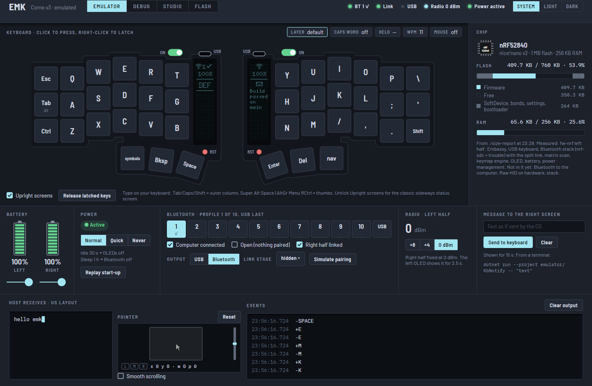 | 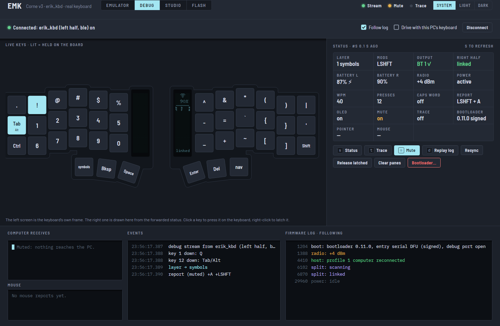 |
| **Studio** | **Flash** |
| 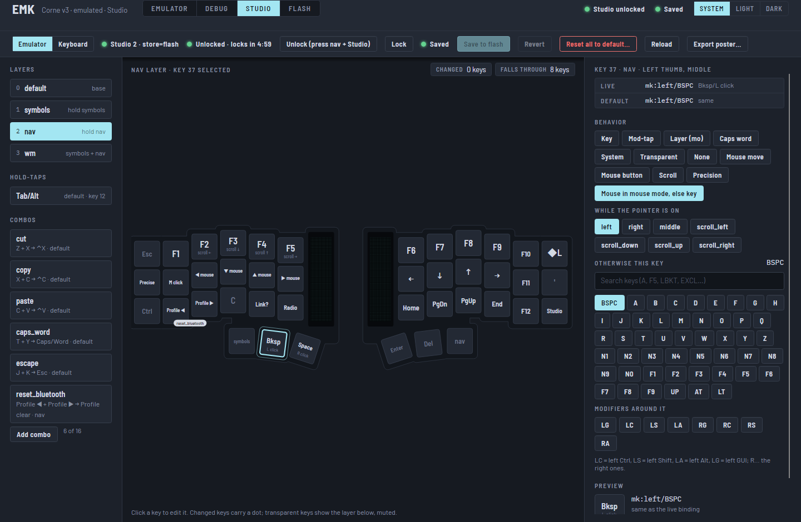 | 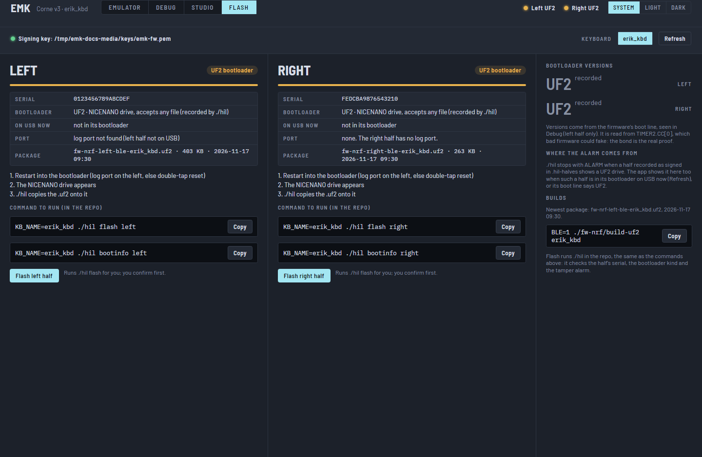 |

- **Emulator**: type on your computer's keyboard (by position) or click keys; both OLEDs come from
  the firmware's own I²C bytes. Batteries, power switches, USB, profiles, link stages, pairing and
  messages can all be played with.
- **Debug**: the real keyboard over its log port: held keys, the left OLED's frame, status, mouse
  reports and the log; it can also press keys on the board.
- **Studio**: the keymap and combos, on the emulator or on the keyboard.
- **Flash**: the halves `./hil` knows and the newest builds, and `./hil flash` behind a button.

In the light theme:

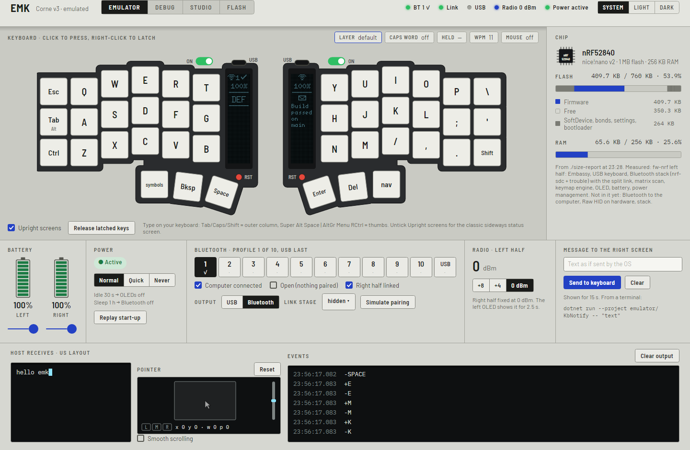

More in [docs/emulator.md](docs/emulator.md), also the Linux simulator (`sim`) that types through
the Corne keymap on any keyboard.

## Development

Architecture, tests, tools and status: [docs/development.md](docs/development.md).
Commit messages and releases: [docs/development.md](docs/development.md#commit-messages), [docs/releasing.md](docs/releasing.md).

## Credits

First of all, thanks to [foostan](https://github.com/foostan) for the
[Corne keyboard (crkbd)](https://github.com/foostan/crkbd). It's a wonderful keyboard: small,
comfortable and open hardware, and the reason this project exists. EMK is only firmware for it;
the design is all foostan's.

A big thank you as well to [ZMK](https://zmk.dev), its creator
[Pete Johanson](https://github.com/petejohanson) and the
[ZMK team and contributors](https://github.com/zmkfirmware/zmk/graphs/contributors). ZMK carried
my Corne through my first years with it: wireless, split and reliable every day. My keymap and
much of what I learned about operating my custom keyboard come from there.

The firmware and app are built on [Embassy](https://embassy.dev),
[trouble-host](https://github.com/embassy-rs/trouble),
[nrf-sdc](https://github.com/alexmoon/nrf-sdc) (Nordic's SoftDevice Controller),
[embedded-graphics](https://github.com/embedded-graphics/embedded-graphics),
[sequential-storage](https://github.com/tweedegolf/sequential-storage),
[Avalonia](https://avaloniaui.net) and [TUnit](https://tunit.dev). The app uses the fonts Barlow,
Barlow Semi Condensed, IBM Plex Mono and Noto Sans Symbols 2 (SIL Open Font License). The pin map
comes from ZMK's `corne` shield, and the keymap from my ZMK config.

## License

MIT for EMK's own code ([LICENSE](LICENSE)); see [THIRD-PARTY.md](THIRD-PARTY.md) for the Nordic
libraries in Bluetooth builds, the fonts and the dependencies.
