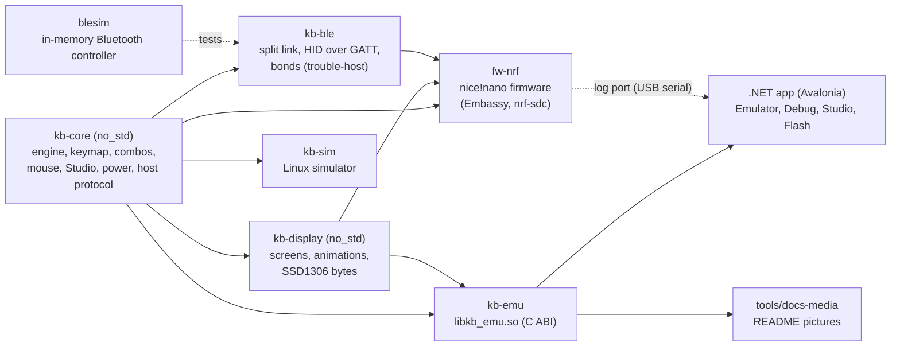

# Development

How EMK is put together, how to test it, and what is still open.

## Architecture



| Path | What |
|---|---|
| `core/` | `no_std` keymap engine: layers, mod-taps, combos, caps word, debounce, mouse keys, Studio, power, the host protocol |
| `display/` | `no_std` OLED screens and animations, and the SSD1306 driver (I²C bytes) |
| `ble/` | Bluetooth: split link, HID over GATT, bonds and settings in flash, without chip-specific code |
| `fw-nrf/` | The firmware for the nice!nano v2 (Embassy, Nordic SoftDevice Controller); standalone build |
| `emu/` | The firmware logic behind a C ABI (`libkb_emu.so`) for the app |
| `blesim/` | An in-memory Bluetooth LE controller: runs the keyboard's Bluetooth code against hosts in `cargo test` |
| `sim/` | Linux simulator: types through the Corne keymap on your own keyboard |
| `emulator/` | The .NET app (`App`), its tests, the SSD1306 model, `kbnotify` and the README renderer (`DocsMedia`) |
| `tools/docs-media/` | Renders `docs/media/` |
| `bench/`, `size-probe/` | Host benchmark and the bare-metal size measurement |

## Tests and tools

```sh
./dev cargo test                                    # all Rust tests, blesim's Bluetooth tests included
./dev cargo clippy --workspace --all-targets
cd emulator && dotnet test                          # TUnit: SSD1306 model, firmware via FFI, rendered windows
./hil test                                          # on the real keyboard: halves linked, a key reaches the output
./docs-media                                        # regenerate docs/media/ (prints what it wrote)
./docs-media --smoke                                # check the generator on a tiny scene
./coverage                                          # line coverage, Rust and .NET (./coverage rust, ./coverage dotnet)
```

`./coverage` runs the tests with line coverage (`cargo llvm-cov` in the dev container, `dotnet
test --coverage` on the host), prints it per part (Rust crate, .NET assembly) and in total, and fails
when a total is under 85 %; CI runs it the same way and keeps the reports (`coverage-rust`,
`coverage-dotnet`). The reports are in `target/coverage/`: `rust.lcov` and `dotnet/*.cobertura.xml`.
Left out of the figures, as tools and test aids rather than code the keyboard runs: `sim`,
`blesim`, `tools/docs-media`, `bench` and `size-probe` (`--exclude` and
`--ignore-filename-regex` in `./coverage`), ble's test flash and the integration tests themselves;
on the .NET side the test projects, `DocsMedia`, the Windows-only `NativeWindowsHid` (CI runs on
Linux) and generated code ([`emulator/coverage.config.xml`](../emulator/coverage.config.xml)). The
firmware (`fw-nrf`) is a workspace of its own, only runs on the chip and isn't measured. A
`kb_emu_*` function only counts as covered when a test in `emu/tests/` calls it: llvm-cov keeps the
counts of the non-test build (the `cdylib`), not those of the crate's own unit tests.

`./dev` runs a command in the Rust container (`localhost/kb-dev`, Rust 1.99 with the
`thumbv7em-none-eabihf` target, made with `podman run` + `podman commit`); `./dev` alone opens a
shell, `./dev --rebuild` recreates the image. VS Code can use the same image through
`.devcontainer/devcontainer.json` (set `"dev.containers.dockerPath": "podman"`).

`./docs-media` makes every picture in this README from the code. The screen close-ups,
`profiles.png` and the layer SVGs come from `tools/docs-media`, which plays scripted keys on
`kb-emu` with a simulated clock and decodes the SSD1306 bytes. The keyboard animations
(`kb-*.gif`, `scene-*.gif`), the layer and combo pictures (`layer-*.png`, `combo-*.png`) and the
app screenshots come from `emulator/DocsMedia`, which runs the same scripts on the app's own
keyboard view and windows, headless; `tools/docs-media` turns their frames into GIFs. The same script gives the same pictures
(only the screenshots' event times differ).

The rest of `docs/`: [firmware.md](firmware.md), [mouse-keys.md](mouse-keys.md),
[emulator.md](emulator.md), [studio-protocol.md](studio-protocol.md),
[performance.md](performance.md), [renode.md](renode.md), and the signed-bootloader and
security notes.

`backup/zmk/` holds local ZMK builds (`.uf2`) to go back to. They are not part of the repository
and shouldn't be published with it.

## Commit messages

Every push to `main` can release: semantic-release reads the commit messages since the last
release, works out the next version and writes `CHANGELOG.md`
([releasing.md](releasing.md)). So commit messages follow the
[Angular commit format](https://github.com/angular/angular/blob/main/contributing-docs/commit-message-guidelines.md):

```text
<type>(<scope>): <subject>          ← max. 100 characters, imperative, lower case, no period

<body: what and why, optional>

<footer: BREAKING CHANGE: ..., Fixes #123, optional>
```

| Type | Use for | Release |
| --- | --- | --- |
| `feat` | A new feature users can see (a key behaviour, a screen, an app window). | minor |
| `fix` | A bug fix users can notice. | patch |
| `perf` | Faster, smaller or lighter on the battery. | patch |
| `revert` | Reverting an earlier commit (`revert: feat(display): ...`). | patch |
| `docs`, `refactor`, `test`, `build`, `ci`, `style`, `chore` | Anything users don't see. | none |

Scopes are optional; when you use one, pick from `core`, `keymap`, `display`, `ble`, `fw-nrf`,
`power`, `mouse`, `studio`, `bootloader`, `app`, `emulator`, `kbnotify`, `sim`, `emu`, `docs`,
`ci`, `deps`, `deps-dev`, `release`, `tools`, `hil`, `bench`
([`commitlint.config.mjs`](../commitlint.config.mjs)). Another scope is a warning, not an error.

```text
feat(display): add a battery screen
fix(ble): reconnect the right half after the left one wakes up
perf(fw-nrf): lower the scan rate while idle
docs: explain mouse keys
```

**Breaking changes** add a `!` after the type or scope and a `BREAKING CHANGE:` footer that says
what users have to do; they release the next major version:

```text
feat(studio)!: store the keymap in a new flash format

BREAKING CHANGE: a keymap saved with Studio before this version isn't read; save it again after flashing.
```

`pnpm install` in the repository root installs the release tooling and a `commit-msg` hook that
runs commitlint on every commit (skip it once with `git commit --no-verify`, remove it with
`rm .git/hooks/commit-msg`, or don't install it: `SKIP_INSTALL_SIMPLE_GIT_HOOKS=1 pnpm install`).
Check a message by hand: `echo "feat(display): add a battery screen" | pnpm exec commitlint`.

## Code analysis

- **The compilers' and analyzers' warnings** fail the build: clippy (pedantic) with `-D
  warnings`, and the .NET Release build with warnings as errors, including SonarAnalyzer.CSharp,
  the C# rules SonarQube Cloud runs.
- **SonarQube Cloud** analyses `main` and pull requests from branches of this repository in CI's
  `sonar` job ([dashboard](https://sonarcloud.io/summary/new_code?id=eriklieben_emk)). It is off
  until the repository variable `SONAR_ORGANIZATION` and the secret `SONAR_TOKEN` are set. The
  job wraps one Release build of the .NET solution with SonarScanner for .NET (from
  [`.config/dotnet-tools.json`](../.config/dotnet-tools.json)), which also picks up the Rust,
  the scripts and the docs, and imports the coverage of the `rust` and `dotnet` jobs (lcov and
  Cobertura); it runs no tests. The settings are in
  [`eng/SonarQube.Analysis.xml`](../eng/SonarQube.Analysis.xml): the same coverage exclusions
  as `./coverage` (plus the firmware and scripts), and the build's own warnings aren't imported
  again (`sonar.cs.roslyn.ignoreIssues`). Fork pull requests get no secrets, so the job is
  skipped for them; it never holds up a release (`continue-on-error`).

## Status

Works:

- Both halves over Bluetooth, with the left half as the keyboard: typing, layers, hold-taps, combos,
  caps word, the split link, USB and Bluetooth output with 10 profiles, the OLED screens, idle
  blanking and deep sleep.
- Covered by tests without hardware: the keymap engine, mouse keys, screens and Studio (unit tests
  and the emulator); the split link, pairing with a code, the HID reports with the mouse, the
  batteries, radio power, Studio's keymap in flash and messages from the computer reaching the
  right half (`blesim`).

Not done yet:

- Messages from the computer (`kbnotify`) on the real keyboard are built and tested in `blesim`,
  but not tried on hardware yet.
- NKRO.
