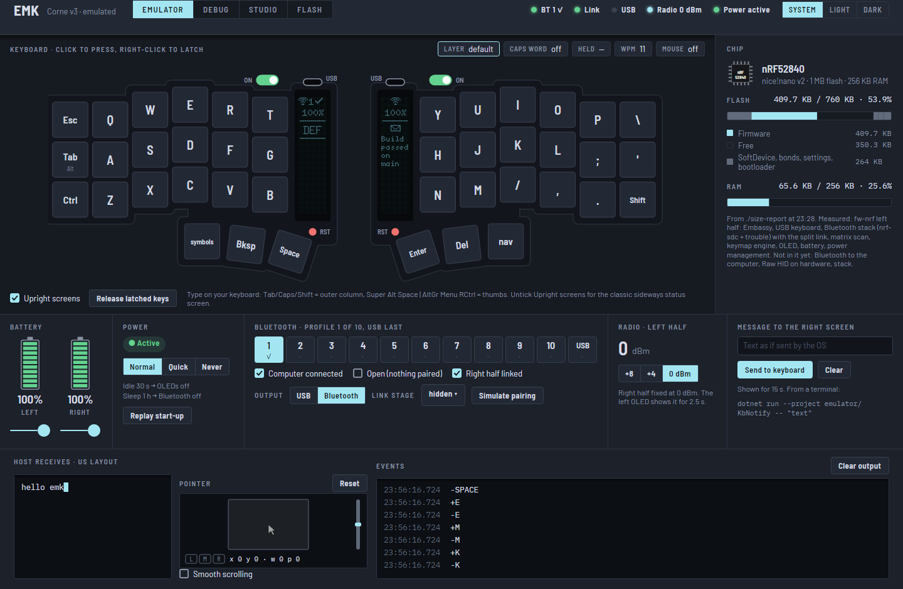
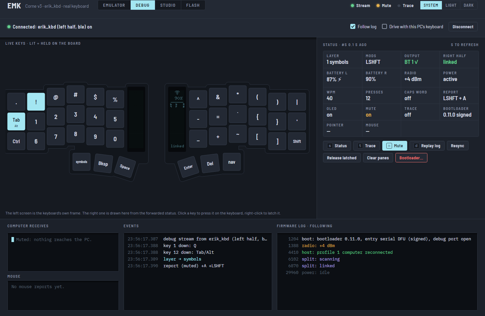
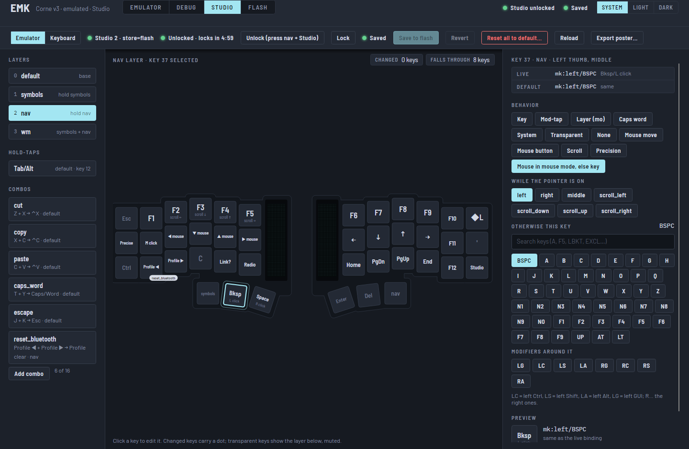
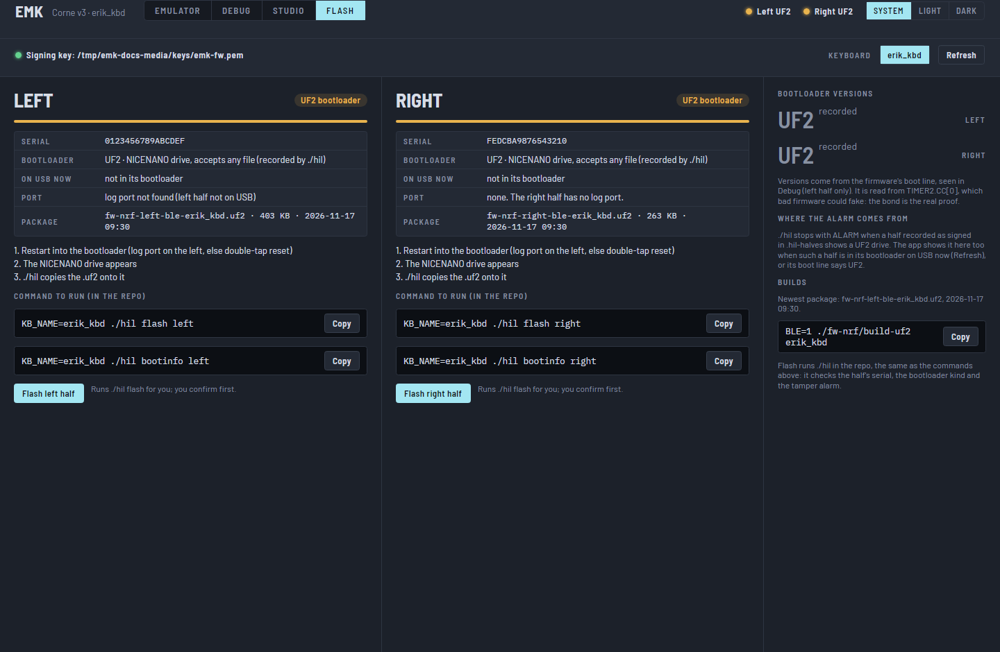

# The EMK app: emulator, debug, Studio, flash

A .NET 10 / Avalonia desktop app (`emulator/App`). The firmware logic runs inside it through
`libkb_emu.so` (crate `emu`, a C ABI), so the emulated keyboard behaves like the real one, down to
the I²C bytes sent to the OLEDs (decoded by a C# SSD1306 model, `emulator/Ssd1306`).

```sh
./emulate                       # builds libkb_emu.so in the dev container, then dotnet run
cd emulator && dotnet test      # TUnit: SSD1306 model, host text, firmware via FFI, rendered windows
```

The theme switch in the top bar picks System, Light or Dark (kept in `~/.config/emk/app.json`).

## Emulator



- Type on your computer's keyboard. Keys map by position, not legend (the same mapping as `sim`):
  Tab / Caps Lock / Shift are the outer column, and the thumbs are `Super Alt Space | AltGr Menu RCtrl`.
- Click a key to press it. Right-click a key to latch it, for combos and holds.
- "Host receives" shows what a computer with a US layout would type; beside it the pointer the mouse
  keys move.
- The OLEDs stand beside the inner column, as on the Corne v3. "Upright screens" switches between
  EMK's portrait screens and a look-alike of ZMK's built-in screen (sideways, as the keyboard
  showed it before).
- Each half has its power switch, USB port (charging) and reset button.
- The chip panel shows the nRF52840's flash map and RAM, and how much `fw-nrf` uses
  (`./size-report`).
- "Simulate pairing" starts a pairing with a code: Events shows the computer's code; type it on the
  emulated keyboard (symbols layer digits) and Enter, or Escape.
- The `Radio` key on the nav layer steps the radio power; the left OLED shows it for a moment.
- Power: OLEDs blank after the idle timeout. In deep sleep their power is cut, and the key that
  wakes the board is not typed, as on the real board. "Quick" uses short timeouts for testing.

## Debug



Connects to the real keyboard's log port (left half on USB): the keys held on the board, the left
OLED's own frame, the right OLED drawn from the forwarded status, the status line, mouse reports and
the firmware log. "Drive with this PC's keyboard" presses keys on the real board.

## Studio



Live keymap editing, on the emulator or on the keyboard: every key and combo of the four layers,
saved to flash, reverted or reset. Writes only work while Studio is unlocked with the physical
`Studio` key (hold nav, press the right outer bottom key); it locks itself after 5 minutes.
The protocol and its rules are in [studio-protocol.md](studio-protocol.md).

## Flash



The halves `./hil` knows, the newest firmware packages in `target/`, and buttons that run
`./hil flash` for you after a confirmation.

## Notifications (`kbnotify`)

The computer sends text to the keyboard over Raw HID (usage page 0xFF60, usage 0x61, 32-byte
reports, format in `core/src/host.rs`). The left half forwards it over the split link, and the right
OLED shows it for 15 seconds.

```sh
dotnet run --project emulator/KbNotify -- "Build passed"          # emulator if running, else keyboard
dotnet run --project emulator/KbNotify -- --emulator "Hi"         # only the emulator
dotnet run --project emulator/KbNotify -- --clear
```

The emulator listens on `$XDG_RUNTIME_DIR/kb-emulator.sock` and also has a message box. The real
keyboard (USB or Bluetooth, Linux and Windows): see the
[README](../README.md#messages-from-the-computer) and [firmware.md](firmware.md#messages-from-the-computer-raw-hid).

## Simulator (Linux, `sim`)

Types through your Corne keymap on any keyboard: reads your real keyboard, types through a virtual
one.

```sh
./dev cargo run -p kb-sim -- --list      # keyboards found
./dev cargo run -p kb-sim -- --watch     # print only: no grab, no typing
./dev cargo run -p kb-sim                # grab the keyboard and type through the Corne keymap
```

Press the physical **Esc** key to quit and release the keyboard.

`sim` reads `/dev/input/event*` and writes `/dev/uinput`. Rootless podman only passes these devices
through when your user can already access them:

```sh
sudo usermod -aG input $USER
echo 'KERNEL=="uinput", GROUP="input", MODE="0660"' | sudo tee /etc/udev/rules.d/99-uinput.rules
sudo udevadm control --reload && sudo udevadm trigger
# log out and back in
```
