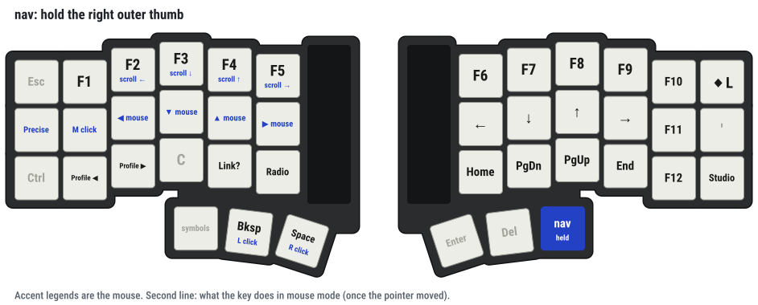

# Mouse keys

The nav layer (hold the right outer thumb) is also a mouse, on the left hand, mirroring the arrows
on HJKL:

| Key (base) | On nav |
|---|---|
| S D F G | move the pointer ◀ ▼ ▲ ▶ |
| A | middle click |
| Tab | hold for precise (slow) movement and scrolling |
| W E R T | F2 F3 F4 F5; in mouse mode scroll ◀ ▼ ▲ ▶ (left/right: horizontal pan) |
| Backspace / Space thumbs | Backspace / Space; in mouse mode left / right click |

## Mouse mode

Mouse mode starts with the first pointer move (S/D/F/G) after nav comes up, and ends when you let
go of nav. Until then W E R T and the thumbs keep their keys: F2-F5, Backspace and Space, so
holding nav to delete still works.

- **On the screen**: in mouse mode the left OLED shows a `MOUSE` bar above the modifier bars.
- **Decided at press**: a click started as a click releases as a click, and a scroll as a scroll,
  even if nav goes first. A Backspace held as Backspace repeats as usual.
- **Not counted**: the precision key doesn't start mouse mode; only movement does.

## How it moves

- **A short tap** moves the pointer one pixel, for precise placement.
- **Holding** eases it in, then speeds it up smoothly to 1800 px/s over about 0.7 s.
- **Diagonals** go as fast as straight lines.
- **Changing direction** bends the path instead of jerking.
- **Releasing** stops it at once.
- **Scrolling** ramps the same way. A tap is exactly one detent. Holding starts slow and eases up
  to 30 detents a second. Releasing stops it at once, and Tab keeps it slow.
- **Smooth scrolling**: Windows and Linux turn on the HID Resolution Multiplier, and then scrolling
  moves in 1/16 detents. macOS doesn't, and gets whole detents in the same rhythm.

All constants are in `kb_core::mouse::MouseConfig::DEFAULT` (`core/src/mouse.rs`).

## On the computer

On USB the mouse is its own HID interface; the keyboard's boot interface is unchanged. Over
Bluetooth the keyboard and mouse share one HID service (report ID 1 keyboard, 2 mouse).

**Computers paired before the mouse was added must pair once more**, because they keep the old
report map cached. Forget the keyboard on the computer, clear the profile (both profile keys on
nav at once), and pair again.
